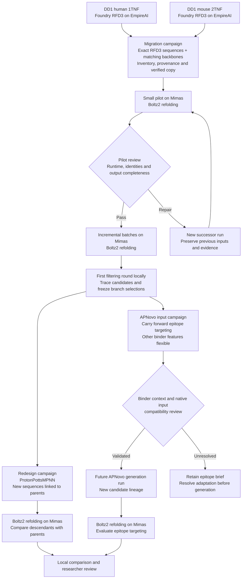

# TNFA migration and downstream campaign plan

Gradually copy sequences and matching backbones from both DD1 Foundry runs on EmpireAI to Mimas for Boltz2 refolding. After the first filtering round, freeze the selected evidence and allocate models to ProtonPottsMPNN sequence redesign, APNovo epitope input development, or both. The APNovo brief preserves epitope targeting while keeping other binder features flexible.

Preparation window: `2026-10-07T16:35:21-04:00` through `2026-10-08T16:35:21-04:00` in America/New_York. The time blocks below are planning targets; output availability and queue time determine progress. Source intakes and paired Boltz2 settings are now frozen, the pilot passed and bulk refolding is running. Downstream generation settings remain pending.

## First collected batch

The [full available output snapshot](../campaigns/2026-10-07_tnfa-foundry-boltz2-migration/runs/2026-10-07_empire-all-available-intake_001/README.md) supersedes the initial transport sample for collection coverage. It includes every regular output file listed at `2026-10-07T16:56:08-04:00`: 2,240 human and 2,184 mouse models, 8,848 native CIF/JSON files, and 4,424 exact binder FASTA exports. All downloaded files match their remote hashes. This expands collection coverage without selecting a quality-ranked set or starting refolding; the first intake remains preserved as a parent.

On 2026-10-07, the [first immutable intake](../campaigns/2026-10-07_tnfa-foundry-boltz2-migration/runs/2026-10-07_empire-first-batch-intake_001/README.md) collected eight human and eight mouse RFD3 models from the two source runs below. All 50 copied source files match their remote hashes. Exact binder sequences were exported from native CIF residue identities: 89 residues for the human batch and 76 for the mouse batch. All 16 candidates have verified sequence traces.

The first intake used each cohort's earliest completed full native batch, without quality ranking. Native metadata flagged chain breaks in two initial models; those models remain retained. Source target identities and residue mappings are verified. The subsequent paired Boltz2 run is described below; redesign and branch selection remain future phases.

## Campaign structure

| Prepared campaign | Scientific question | Upstream evidence |
| --- | --- | --- |
| [Migration and first filtering](../campaigns/2026-10-07_tnfa-foundry-boltz2-migration/README.md) | Which exact RFD3 candidates merit downstream work after initial refolding? | Both DD1 source runs |
| [ProtonPottsMPNN redesign](../campaigns/2026-10-07_tnfa-protonpottsmpnn-redesign/README.md) | Can redesigned descendants improve the chosen criteria relative to their parents? | Frozen first-round selection with candidate and observation traces |
| [APNovo epitope inputs](../campaigns/2026-10-07_tnfa-apnovo-epitope/README.md) | Can selected binding geometry guide new designs targeting the same epitope? | Frozen first-round selection and mapped epitope evidence |

The two downstream folders reserve the agreed objectives. Candidate assignments happen after filtering. Membership may overlap if each branch records its own rationale. Split into additional species or epitope campaigns only when the data support distinct scientific questions.

## Source runs and sequence intake

The intended sources are the current DD1 runs recorded at preparation time:

- Human: `2026-10-06_dd1-human-tnfa-pocket/2026-10-07_102236-0400-dd1-human-1tnf-ac-103-110-rfd3-50000-empire_001`.
- Mouse: `2026-10-06_dd1-mouse-tnfa-pocket/2026-10-07_102236-0400-dd1-mouse-2tnf-ab-71-112-rfd3-50000-empire_001`.

The researcher confirmed that RFD3 generates sequence alongside backbone. Use those exact native sequences as the baseline; an initial MPNN pass is not part of this plan. Verify each emitted sequence against its matching model and record whether the sequence source is native FASTA or a documented extraction from native coordinates. An extraction requires the original coordinate hash and the extraction method/version. Backbone geometry alone is insufficient to establish an exact sequence.

Existing source records describe RFD3-only preparation and do not certify current remote completion or available output counts. At intake, resolve the actual EmpireAI attempt and output artifacts through Fleet; retain that execution evidence in receipts. If a different source run is used, record it explicitly in a new frozen run with its parent link.

Human and mouse remain distinct source cohorts. Preserve each source's target construct, native residue numbering, chain roles/copies, topology and chemistry. Confirm the mapping to the soluble trimer used for refolding. Do not infer human/mouse pairing from output indices or residue numbers, and do not silently add cross-species refolding.

## First 24 hours

| Elapsed time | Work | Evidence or deliverable |
| --- | --- | --- |
| 0–2 hours | Inventory completed outputs from both runs; identify exact sequences and models, partial files and duplicates. Resolve Fleet locations and the pinned Boltz2 runtime. | Source manifest, hashes, exact candidate records and a proposed pilot set |
| 2–6 hours | Review pilot choices, freeze native inputs/settings, preview transport, then copy and verify selected files. Validate the actual Mimas adapter, checkpoint and input parser before the pilot. | Immutable pilot run with both applicable source parent links, verified transport receipt and preflight evidence |
| 6–12 hours | Refold the pilot; inspect completeness and chain identity. If successful, expand gradually with a bounded queue and immutable batch manifests. | Native structures, confidence/PAE sidecars, runtime receipts and batch counts |
| 12–18 hours | Collect selected verified copies for local scoring. Trace every candidate before ranking; record retained/rejected counts and reasons. | Source-located observations and frozen branch selection evidence |
| 18–24 hours | Populate branch inputs from reviewed selections. Prepare ProtonPottsMPNN settings and APNovo epitope mappings. Freeze a branch run only when its native inputs and settings are resolved. | Traceable redesign brief and epitope-focused APNovo brief, or an explicit list of pending decisions |

The researcher subsequently authorized all 4,424 collected sequences against both species and selected the exact Foundry constructs. The effective successor is `2026-10-07_boltz2-paired-foundry-trimers_001`: 8,848 complexes. It uses human 152-residue and mouse 148-residue target chains in three copies, binder chain D, and explicit source disulfide bonds. Boltz2 2.2.1/checkpoint hash, seed 0 per native batch, three recycles, 200 sampling steps, one sample, target MSAs and query-only binder MSAs are frozen with exact provenance. No templates or epitope restraints are applied.

CPU preparation job 6135 generated and natively validated both exact target MSAs and all 8,848 input files. GPU pilot 6139 validated four complexes (one binder from each source cohort against each species), including exact four-chain identities and finite coordinates/confidence/PAE/PDE. Bulk job 6143 is a 139-task array, up to 64 complexes per task, concurrency one, gated on pilot success. At the 2026-10-07T17:49:04-04:00 audit, task 6143_0 was running; CPU, finished pilot GPU, and active bulk GPU resource logs all passed the pinned checker. Accepted scripts and job IDs are retained separately from frozen inputs. No first-round ranking or downstream branch selection has occurred.

If remote output availability or queueing delays a phase, finish the inventory and branch briefs that can be supported, and record the remaining dependency. The 24-hour window does not imply guaranteed completion of either downstream generation route. Progress is recorded separately from frozen inputs; alerts and automatic continuation remain deferred.

## Scientific choices at phase boundaries

Before the first Boltz2 run, resolve exact target sequences, species, assembly, binder/target chain IDs and copies, chemistry, MSA strategy, model/checkpoint/version, seeds, sampling settings, resources and native adapter. Select structural score methods, definitions, units, thresholds and handling of missing/failed outputs explicitly before ranking. Leave numeric criteria unset until that review.

At the first filtering boundary, choose how confidence, interface geometry, structural agreement with the source model, epitope contacts and sequence diversity enter the ranking. These are candidate review dimensions, not an established score formula. Retain raw score artifacts and source locations. Computational confidence does not establish binding or experimental pH selectivity.

At the redesign boundary, select parent candidates, fixed versus mutable positions, disulfide constraints, protonation criteria, pH objectives, sampling/seeds, checkpoint, version and execution host. [ProtonPottsMPNN](https://github.com/christian-creator/ProtonPottsMPNN) supports protonation-aware redesign on a fixed backbone. Its settings and resulting scores require separate validation for this TNFA context. The project objective of binding at pH 7.4 and release at pH 6.0 must be translated into explicit design criteria; do not treat ordinary Boltz2 predictions as a pH-switch assay.

At the APNovo boundary, map the selected epitope to exact target residues, chain identities and supporting coordinates. Record contact geometry and a proposed native representation; do not automatically freeze the entire parent binder as a motif. Other binder features remain flexible unless native requirements or a later researcher choice impose constraints. [APNovo's published pipeline](https://github.com/google-deepmind/alphaprotein-novo) focuses on enzyme design through catalytic motif scaffolding and ligand context. Validate an appropriate protein target/binder representation and adapter before claiming these briefs are runnable APNovo inputs.

## Lineage and storage

Use `drafts/<campaign_id>/` for editable preparation, with the four standard stage directories. The migration campaign now contains a frozen source intake; the two downstream campaigns still have empty `runs/` directories. Stage placeholders and draft JSON remain planning material, not native molecular inputs or completed scientific evidence.

Once settings and inputs are agreed, use `workspace.py new` to create a new immutable date-first run, with `--parent-run CAMPAIGN/RUN` for each actual upstream run. Migration runs link to the appropriate EmpireAI generation run or runs. Redesign and APNovo runs link to the actual filtering run and frozen selection evidence; candidate records carry the exact sequence parents and generation method. For APNovo generation, distinguish a conditioning/reference relationship from literal sequence derivation.

Changed inputs or scientific settings require a successor run. Keep progress in `state.json` and transport/execution evidence in `receipts/`. Keep bulk generation canonical on EmpireAI and bulk refolding canonical on Mimas; collect only explicitly selected, hash-verified files. Copy incrementally and preserve all unique source data.

Before cross-campaign ranking, run `candidate trace` and freeze candidate/observation traces, ranking method/version, selected IDs and branch rationale. Back up ignored draft, run, registry and selection records with their source artifacts through Fleet and record the verified backup receipt. Existing workflow pins and historical runs remain preserved. Final eligibility and submission require researcher review under [the challenge requirements](CHALLENGE.md).
